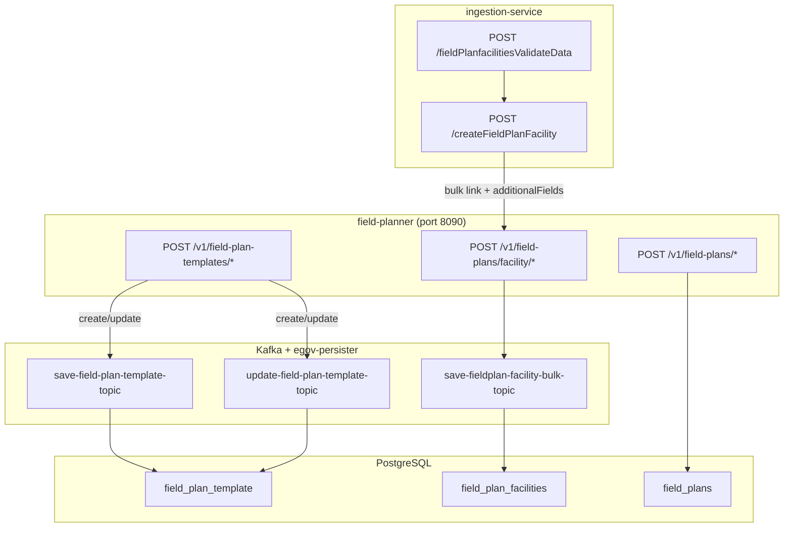
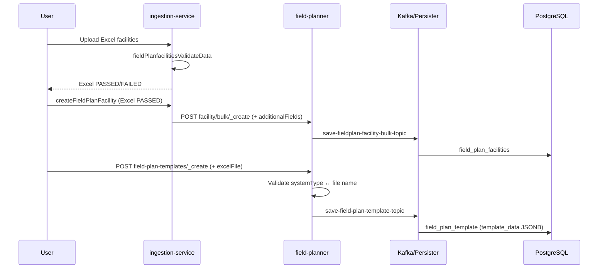
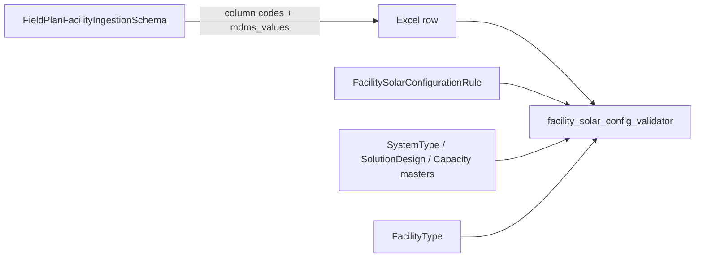

# Technical Design: Field Plan Template, Facility Linking & Ingestion

## 1. Objective

This document describes the functional and technical design of the following changes:

1. **New `field_plan_template` entity** in the `field-planner` service (CRUD via API).
2. **ICC Excel file validation** based on `systemType` when creating or updating a template.
3. **`additionalFields` enrichment** during bulk facility ↔ field plan linking (`ingestion-service`).
4. **Solar validation** of field plan facilities via ingestion (`fieldPlanfacilitiesValidateData`).

---

## 2. Service Overview



| Service | Context path | Role |
|---------|--------------|------|
| `field-planner` | `/field-planner` | Field plans, facility links, ICC templates |
| `ingestion-service` | (FastAPI) | Excel validation + field plan ingestion orchestration |

---

## 3. Data Model

### 3.1 Table `field_plan_template` (new)

**Migration:** `V20260611120000__field_plan_template_create_ddl.sql`

| DB Column | Type | Required | Description |
|-----------|------|----------|-------------|
| `id` | `VARCHAR` PK | Yes | UUID generated on create |
| `field_plan_id` | `VARCHAR` FK → `field_plans(id)` | Yes | Parent field plan |
| `system_type` | `VARCHAR` | Yes | Solar system type (display label or MDMS code) |
| `total_capacity` | `VARCHAR` | Yes | Total capacity (e.g. `0.25 kWp`) |
| `template_data` | `JSONB` | Yes (default `{}`) | Template business data (free-form JSON) |
| `tenant_id` | `VARCHAR` | Yes | Digit tenant (e.g. `in`) |
| `created_by` | `VARCHAR` | No | Creator user UUID |
| `last_modified_by` | `VARCHAR` | No | Last modifier user UUID |
| `created_time` | `BIGINT` | No | Epoch ms |
| `last_modified_time` | `BIGINT` | No | Epoch ms |

**Constraints & indexes:**
- FK: `field_plan_id` → `field_plans(id)`
- Indexes: `tenant_id`, `field_plan_id`
- Unique: `(field_plan_id, system_type, total_capacity)`

> **Note:** the ICC Excel file uploaded via the API is **not stored** in the database. Only `template_data` (JSON) is persisted.

### 3.2 Table `field_plan_facilities` (existing — enriched column)

| DB Column | Type | Description |
|-----------|------|-------------|
| `additional_details` | `JSONB` | Stores `additionalFields` (Digit schema) |

**`additionalFields.fields[]` keys populated by ingestion:**

| `key` | Excel Source | Example value |
|-------|--------------|---------------|
| `systemType` | *System Type* column | `DC Off-grid` |
| `solarSolutionDesignType` | *Solution Design Type* column | `Off-grid DC System` |
| `totalSystemCapacity` | *Total System Capacity* column | `0.25 kWp` |

API structure:

```json
{
  "additionalFields": {
    "schema": "FieldPlanFacility",
    "version": 1,
    "fields": [
      { "key": "systemType", "value": "DC Off-grid" },
      { "key": "solarSolutionDesignType", "value": "Off-grid DC System" },
      { "key": "totalSystemCapacity", "value": "0.25 kWp" }
    ]
  }
}
```

---

## 4. API `field-planner` — Field Plan Template (new)

**Base URL:** `POST /field-planner/v1/field-plan-templates`

### 4.1 `POST /_create`

Creates one or more templates. Async persistence via Kafka.

| Attribute | Value |
|-----------|-------|
| Content-Type | `multipart/form-data` |
| HTTP Status | `202 ACCEPTED` |

**Multipart parts:**

| Part | Type | Required | Description |
|------|------|----------|-------------|
| `request` | `application/json` | Yes | `FieldPlanTemplateBulkRequest` |
| `excelFile` | `.xls` / `.xlsx` file | Yes | ICC template — validated but **not persisted** |

**JSON body (`request`):**

```json
{
  "RequestInfo": { "...": "..." },
  "FieldPlanTemplates": [
    {
      "tenantId": "in",
      "fieldPlanId": "FP/2025/000001",
      "systemType": "DC Off-grid",
      "totalCapacity": "0.25 kWp",
      "templateData": {
        "sections": [],
        "metadata": { "version": 1 }
      }
    }
  ]
}
```

**`FieldPlanTemplate` fields:**

| JSON Field | Type | Required | Persisted | Description |
|------------|------|----------|-----------|-------------|
| `id` | `string` | No (generated) | Yes | Unique identifier |
| `tenantId` | `string` | Yes | Yes | Tenant |
| `fieldPlanId` | `string` | Yes | Yes | Field plan reference |
| `systemType` | `string` | Yes | Yes | System type |
| `totalCapacity` | `string` | Yes | Yes | Total capacity |
| `templateData` | `object` | No | Yes (JSONB) | Template data |
| `auditDetails` | `object` | No (enriched) | Yes | Timestamp / author |

**Response:**

```json
{
  "ResponseInfo": { "status": "successful" },
  "FieldPlanTemplates": [ { "id": "...", "...": "..." } ]
}
```

---

### 4.2 `POST /_update`

Updates one or more existing templates.

| Attribute | Value |
|-----------|-------|
| Content-Type | `multipart/form-data` |
| HTTP Status | `200 OK` |

| Part | Required |
|------|----------|
| `request` | Yes (`id` required on each template) |
| `excelFile` | No (validated if provided) |

`templateData` is merged with the existing value in the database.

---

### 4.3 `POST /_search`

Synchronous database search (standard JSON).

| Attribute | Value |
|-----------|-------|
| Content-Type | `application/json` |
| HTTP Status | `200 OK` |

**Query params (`URLParams`):**

| Param | Type | Description |
|-------|------|-------------|
| `tenantId` | `string` | Required |
| `limit` | `int` | Pagination (service config default) |
| `offset` | `int` | Pagination |
| `lastChangedSince` | `long` | Filter `last_modified_time >=` |

**Body:**

```json
{
  "RequestInfo": { "...": "..." },
  "FieldPlanTemplate": {
    "id": ["template-uuid-1"],
    "fieldPlanId": ["FP/2025/000001"],
    "systemType": ["DC Off-grid"],
    "totalCapacity": ["0.25 kWp"]
  }
}
```

**Response:**

```json
{
  "ResponseInfo": { "status": "successful" },
  "FieldPlanTemplates": [ "..." ],
  "TotalCount": 1
}
```

---

### 4.4 Excel File ↔ `systemType` Validation

Applied in the controller **before** the service call (`FieldPlanTemplateValidator.validateTemplateFileForWrite`).

| `systemType` (label or MDMS code) | Expected Excel file (base name) |
|-----------------------------------|---------------------------------|
| `AC Off-grid` / `AC_OFF_GRID` | `ICC Report_Offgrid_With RMS_Single Phase & Three Phase_` |
| `AC Hybrid` / `AC_HYBRID` | `ICC Report_Hybrid_With RMS_Single Phase & Three Phase_3.0` |
| `DC Off-grid` / `DC_OFF_GRID` | `ICC Report_DC System` |
| `AC On-grid` / `AC_ON_GRID` | `ICC Report_Ongrid_Single Phase & Three Phase 2.0` |

**Rules:**
- Allowed extensions: `.xls`, `.xlsx`
- Comparison on **base name** (without extension), case-insensitive
- `/_create`: file required
- `/_update`: file optional; validated only if provided
- `fieldPlanId` must exist in `field_plans`

**Error codes:**

| Code | Description |
|------|-------------|
| `MISSING_TEMPLATE_FILE_N` | File required on create |
| `INVALID_TEMPLATE_FILE_N` | Invalid extension or file name |
| `UNSUPPORTED_SYSTEM_TYPE_N` | Unrecognized systemType |
| `INVALID_FIELDPLAN_N` | fieldPlanId does not exist |

---

### 4.5 Kafka & persister

| Topic | Action |
|-------|--------|
| `save-field-plan-template-topic` | INSERT `field_plan_template` |
| `update-field-plan-template-topic` | UPDATE `field_plan_template` |

Config: `FieldPlanner-persister.yml` + `application.properties`

---

## 5. API `field-planner` — Field Plan & Facilities (existing)

**Base URL:** `/field-planner/v1/field-plans`

| Method | Path | Content-Type | Status | Description |
|--------|------|--------------|--------|-------------|
| POST | `/_create` | JSON | 202 | Create a field plan |
| POST | `/_update` | JSON | 200 | Update a field plan |
| POST | `/_search` | JSON | 200 | Search field plans |
| POST | `/facility/_create` | JSON | 202 | Link 1 facility |
| POST | `/facility/bulk/_create` | JSON | 202 | Link N facilities (async Kafka) |
| POST | `/facility/_search` | JSON | 200 | Search facility links |
| POST | `/facility/_unassign` | JSON | 202 | Unlink 1 facility |
| POST | `/facility/bulk/_unassign` | JSON | 202 | Unlink N facilities (async) |

### 5.1 `FieldPlanFacility` — API fields

| JSON Field | Type | Required | Description |
|------------|------|----------|-------------|
| `id` | `string` | No (generated) | Link ID |
| `facilityId` | `string` | Yes | Facility registry ID |
| `fieldPlanId` | `string` | Yes | Field plan ID |
| `tenantId` | `string` | Yes | Tenant |
| `isdeleted` | `boolean` | No | Soft delete |
| `additionalFields` | `object` | No | Solar config (see §3.2) |
| `auditDetails` | `object` | No | Audit trail |
| `rowVersion` | `int` | No | Optimistic locking version |

### 5.2 Bulk create — ingestion payload

Target endpoint: `POST /field-planner/v1/field-plans/facility/bulk/_create`

```json
{
  "RequestInfo": { "...": "..." },
  "FieldPlanFacilities": [
    {
      "facilityId": "FAC/2025/000123",
      "fieldPlanId": "FP/2025/000001",
      "isdeleted": false,
      "tenantId": "in",
      "additionalFields": {
        "schema": "FieldPlanFacility",
        "version": 1,
        "fields": [
          { "key": "systemType", "value": "DC Off-grid" },
          { "key": "solarSolutionDesignType", "value": "Off-grid DC System" },
          { "key": "totalSystemCapacity", "value": "0.25 kWp" }
        ]
      }
    }
  ]
}
```

**Kafka:** `save-fieldplan-facility-bulk-topic` → consumer → `save-fieldplan-facility-topic` → persister.

---

## 6. API `ingestion-service` — Field Plan Facilities

### 6.1 `POST /fieldPlanfacilitiesValidateData` (validation)

Validates an Excel file **before** creation / linking.

| Parameter | Type | Default | Description |
|-----------|------|---------|-------------|
| `facility_file` | `UploadFile` | — | Excel file |
| `facility_sheet_name` | `string` | `FacilityMapping` | Facilities sheet |
| `boundary_sheet_name` | `string` | `BoundaryCodes` | Boundaries sheet |
| `request_info` | `string` (JSON) | `""` | Digit `RequestInfo` |

**MDMS schema:** `data-ingestion.FieldPlanFacilityIngestionSchema`

**Validations executed:**
1. Standard facility validation (`project_facility_validation`)
2. Solar matrix validation (`validate_facility_solar_configuration`) — rows with *Included in Field Plan = Yes* only

**Expected solar Excel columns:**

| Column (MDMS label) | Schema code | Example |
|---------------------|-------------|---------|
| Type of HC | `facility_type` | `SC`, `PHC`, `ANGANWADI` |
| System Type | `system_type` | `DC Off-grid` |
| Solution Design Type | `solution_design_type` | `Off-grid DC System` |
| Total System Capacity | `total_system_capacity` | `0.25 kWp` |
| Included in Field Plan | `include_in_fieldplan` | `Yes` / `No` |

**Response:** Excel file with `status` (`PASSED`/`FAILED`) and `error` columns.

---

### 6.2 `POST /createFieldPlanFacility` (create / link)

| Parameter | Type | Description |
|-----------|------|-------------|
| `facility_file` | `UploadFile` | Validated Excel (all rows `PASSED`) |
| `facility_sheet_name` | `string` | Facilities sheet |
| `fieldplan_id` | `string` | Target field plan ID |
| `request_info` | `string` (JSON) | `RequestInfo` |

**Behavior:**
- Rejects if any row is not `PASSED`
- For each row with *Included in Field Plan = Yes* and an existing `facilityId`:
  - Builds `additionalFields` from solar columns
  - Calls `field-planner` bulk create
- Handles link / unlink based on current status and *Included in Field Plan* column
- Adds result column `Field Plan Linking Status`

**Columns read (partial match, case-insensitive):**
- `Included in Field Plan`
- `Facility Id`
- `System Type`
- `Solution Design Type`
- `Total System Capacity`

---

## 7. Solar Validation Rules (ingestion)

**MDMS source:** `facility.FacilitySolarConfigurationRule`  
**Fallback:** 16 hardcoded rules if MDMS is empty (`facility_solar_config_validator.py`)

### 7.1 Allowed matrix (excerpt)

| Facility Type | System Type | Solution Design Type | Capacity (kWp) |
|---------------|-------------|------------------------|----------------|
| SC | DC_OFF_GRID | OFF_GRID_DC_SYSTEM | 0.25, 0.5 |
| SC | AC_OFF_GRID | NO_DELIVERY_NO_COLDCHAIN | 1.0 |
| SC | AC_OFF_GRID | DELIVERY_ROOM_ONLY | 2.0 |
| SC | AC_OFF_GRID | DELIVERY_ROOM_COLDCHAIN | 3.0 |
| SC | AC_OFF_GRID | COLDCHAIN_ONLY | 3.0 |
| PHC | AC_OFF_GRID | PHC_* (5 variants) | 5.0 – 8.0 |
| PHC | AC_HYBRID | AC_HYBRID_SYSTEM | 7.0, 10.0 |
| ANGANWADI | AC_OFF_GRID | LIGHT_FAN_EQUIPMENT | 0.63, 1.0 |
| ANGANWADI | DC_OFF_GRID | ONLY_LIGHT_FAN | 0.25 |

### 7.2 Business rules

| Case | Rule |
|------|------|
| Combination covered by the matrix | (solution, capacity) pair must match an MDMS row |
| Covered combination | `Custom Solution Design` + `Custom Capacity` always allowed |
| Uncovered facility type or facility+system pair | Custom + Custom only |
| Row not included in field plan | Solar validation skipped |

**Associated MDMS masters:**
- `facility.SystemType`
- `facility.SolarSolutionDesignType`
- `facility.SolarSystemCapacity`
- `facility.FacilitySolarConfigurationRule`

Reference files: `docs/facility-registry/master-data-schema/`

---

## 8. Recommended End-to-End Flow



---

## 9. Reference Source Files

### field-planner

| File | Role |
|------|------|
| `web/controllers/FieldPlanTemplateApiController.java` | Template endpoints |
| `web/controllers/FieldPlannerApiController.java` | Field plan & facility endpoints |
| `web/models/FieldPlanTemplate.java` | API / persistence model |
| `validator/FieldPlanTemplateValidator.java` | Template business validation |
| `util/FieldPlanTemplateConstants.java` | systemType → ICC file mapping |
| `service/FieldPlanTemplateService.java` | Create/update/search logic |
| `resources/db/migration/main/V20260611120000__field_plan_template_create_ddl.sql` | DDL |
| `resources/FieldPlanner-persister.yml` | Kafka → SQL mapping |

### ingestion-service

| File | Role |
|------|------|
| `app/api/endpoints/file_ingestion.py` | Validate + create endpoints |
| `app/utils/convertor.py` | `build_field_plan_facility_bulk_entry` |
| `app/utils/fieldplan_service_client.py` | Field-planner bulk create client |
| `app/utils/facility_solar_config_validator.py` | MDMS solar matrix |
| `app/utils/facility_validator.py` | `field_plan_facility_validation` |

---

## 10. Deployment Prerequisites

| # | Action |
|---|--------|
| 1 | Run Flyway migration `V20260611120000__field_plan_template_create_ddl.sql` |
| 2 | Create Kafka topics `save-field-plan-template-topic`, `update-field-plan-template-topic` |
| 3 | Deploy persister config (`FieldPlanner-persister.yml`) |
| 4 | Load MDMS masters (see §11 — `facility.*` + `data-ingestion.FieldPlanFacilityIngestionSchema`) |
| 5 | Update `data-ingestion.FieldPlanFacilityIngestionSchema` with solar columns (see §11.7) |

---

## 11. MDMS Masters — Schemas & Sample Data

This section documents the MDMS masters required for **field plan facility validation** (`fieldPlanfacilitiesValidateData`), **Excel template generation**, and **dropdown value resolution** during ingestion.

**Reference files (repository):** `docs/facility-registry/master-data-schema/`

**Target tenant:** `in`

### 11.1 Master overview

| MDMS schema code | Module | Type | Used by | Reference file |
|------------------|--------|------|---------|----------------|
| `facility.SystemType` | `facility` | Master data | Solar validation, ICC template validation, Excel dropdowns | `SystemType.json` |
| `facility.SolarSolutionDesignType` | `facility` | Master data | Solar validation, `additionalFields.solarSolutionDesignType` | `SolarSolutionDesignType.fieldplan.json` |
| `facility.SolarSystemCapacity` | `facility` | Master data | Solar validation, capacity kWp resolution | `SolarSystemCapacity.json` |
| `facility.FacilitySolarConfigurationRule` | `facility` | Master data (rules) | Solar matrix validation | `FacilitySolarConfigurationRule.schema.json` + `.data.json` |
| `facility.FacilityType` | `facility` | Master data | Facility type dropdown + rule `facilityType` codes | `FacilityType.json` (extend for field plan) |
| `data-ingestion.FieldPlanFacilityIngestionSchema` | `data-ingestion` | Ingestion schema | Excel columns, MDMS dropdowns, validation | To create (see §11.7) |

**Validation flow:**



---

### 11.2 `facility.SystemType`

**Purpose:** Defines allowed solar system types. Excel displays `name`; validation resolves to `code`.

**Suggested JSON schema (Digit master):**

```json
{
  "tenantId": "in",
  "module": "facility",
  "SystemType": [
    { "active": true, "code": "DC_OFF_GRID", "name": "DC Off-grid" },
    { "active": true, "code": "AC_OFF_GRID", "name": "AC Off-grid" },
    { "active": true, "code": "AC_HYBRID", "name": "AC Hybrid" },
    { "active": true, "code": "AC_ON_GRID", "name": "AC On-grid" }
  ]
}
```

> **Note:** `AC_ON_GRID` is required for ICC template validation (`FieldPlanTemplateConstants`) but is not yet present in the current `SystemType.json` seed file. Add it when enabling on-grid templates.

**Field attributes:**

| Field | Type | Required | Description |
|-------|------|----------|-------------|
| `code` | `string` | Yes | MDMS code (e.g. `DC_OFF_GRID`) |
| `name` | `string` | Yes | Display label shown in Excel |
| `active` | `boolean` | Yes | Whether the value is selectable |

---

### 11.3 `facility.SolarSolutionDesignType`

**Purpose:** Solution design options for field plan facilities. Use the **field plan** master set (not the legacy facility-registry list).

**Sample data** (`SolarSolutionDesignType.fieldplan.json`):

```json
{
  "tenantId": "in",
  "module": "facility",
  "SolarSolutionDesignType": [
    { "active": true, "code": "CUSTOM", "name": "Custom Solution Design" },
    { "active": true, "code": "OFF_GRID_DC_SYSTEM", "name": "Off-grid DC System" },
    { "active": true, "code": "NO_DELIVERY_NO_COLDCHAIN", "name": "No Delivery Room, No Cold-chain" },
    { "active": true, "code": "DELIVERY_ROOM_ONLY", "name": "Delivery Room Only" },
    { "active": true, "code": "DELIVERY_ROOM_COLDCHAIN", "name": "Delivery Room + Cold-chain" },
    { "active": true, "code": "COLDCHAIN_ONLY", "name": "Cold-chain Only" },
    { "active": true, "code": "PHC_NO_DELIVERY_NO_COLDCHAIN_LAB", "name": "No Delivery Room, No Cold-chain, With/Without Lab" },
    { "active": true, "code": "PHC_DELIVERY_ROOM", "name": "Delivery Room" },
    { "active": true, "code": "PHC_COLDCHAIN_LAB", "name": "Cold-chain + Lab" },
    { "active": true, "code": "PHC_DELIVERY_COLDCHAIN_LAB", "name": "Delivery Room + Cold-chain + Lab" },
    { "active": true, "code": "PHC_DELIVERY_COLDCHAIN_LAB_DENTAL_ADMIN", "name": "Delivery Room + Cold-chain + Lab + Dental Unit + Admin" },
    { "active": true, "code": "AC_HYBRID_SYSTEM", "name": "AC Hybrid System" },
    { "active": true, "code": "LIGHT_FAN_EQUIPMENT", "name": "Light + Fan + Equipment" },
    { "active": true, "code": "ONLY_LIGHT_FAN", "name": "Only Light & Fan" }
  ]
}
```

**Field attributes:**

| Field | Type | Required | Description |
|-------|------|----------|-------------|
| `code` | `string` | Yes | MDMS code stored in rules / `additionalFields` |
| `name` | `string` | Yes | Excel display label |
| `active` | `boolean` | Yes | Selectable flag |

---

### 11.4 `facility.SolarSystemCapacity`

**Purpose:** Allowed capacity values. Validation uses `capacityKwp` (numeric) for matrix matching; Excel shows `name`.

**Sample data** (`SolarSystemCapacity.json`):

```json
{
  "tenantId": "in",
  "module": "facility",
  "SolarSystemCapacity": [
    { "active": true, "code": "0.25", "name": "0.25 kWp", "capacityKwp": 0.25 },
    { "active": true, "code": "0.5", "name": "0.5 kWp", "capacityKwp": 0.5 },
    { "active": true, "code": "0.63", "name": "0.63 kWp", "capacityKwp": 0.63 },
    { "active": true, "code": "1", "name": "1 kWp", "capacityKwp": 1 },
    { "active": true, "code": "2", "name": "2 kWp", "capacityKwp": 2 },
    { "active": true, "code": "3", "name": "3 kWp", "capacityKwp": 3 },
    { "active": true, "code": "5", "name": "5 kWp", "capacityKwp": 5 },
    { "active": true, "code": "6", "name": "6 kWp", "capacityKwp": 6 },
    { "active": true, "code": "7", "name": "7 kWp", "capacityKwp": 7 },
    { "active": true, "code": "8", "name": "8 kWp", "capacityKwp": 8 },
    { "active": true, "code": "10", "name": "10 kWp", "capacityKwp": 10 },
    { "active": true, "code": "CUSTOM", "name": "Custom Capacity", "capacityKwp": 0 }
  ]
}
```

**Field attributes:**

| Field | Type | Required | Description |
|-------|------|----------|-------------|
| `code` | `string` | Yes | MDMS code |
| `name` | `string` | Yes | Excel display label |
| `capacityKwp` | `number` | Yes | Numeric capacity used in rule matching |
| `active` | `boolean` | Yes | Selectable flag |

---

### 11.5 `facility.FacilitySolarConfigurationRule`

**Purpose:** Business matrix — allowed tuples `(facilityType, systemType, solutionDesignType, capacityKwp)`. Loaded by `facility_solar_config_validator.py` via `mdms_client.fetch_mdms_records()`. Falls back to 16 hardcoded rules if MDMS is empty.

#### 11.5.1 Schema definition

**File:** `FacilitySolarConfigurationRule.schema.json`

```json
{
  "tenantId": "in",
  "code": "facility.FacilitySolarConfigurationRule",
  "description": "Allowed facility type + system type + solution design + capacity tuples",
  "definition": {
    "$schema": "http://json-schema.org/draft-07/schema#",
    "type": "object",
    "properties": {
      "facilityType": { "type": "string" },
      "systemType": { "type": "string" },
      "solutionDesignType": { "type": "string" },
      "capacityKwp": { "type": "number" },
      "active": { "type": "boolean" }
    },
    "required": [
      "facilityType",
      "systemType",
      "solutionDesignType",
      "capacityKwp",
      "active"
    ],
    "x-unique": [
      "facilityType",
      "systemType",
      "solutionDesignType",
      "capacityKwp"
    ],
    "x-ref-schema": [
      { "fieldPath": "facilityType", "schemaCode": "facility.FacilityType" },
      { "fieldPath": "systemType", "schemaCode": "facility.SystemType" },
      { "fieldPath": "solutionDesignType", "schemaCode": "facility.SolarSolutionDesignType" }
    ]
  },
  "isActive": true
}
```

#### 11.5.2 Sample data (16 rules)

**File:** `FacilitySolarConfigurationRule.data.json`

| facilityType | systemType | solutionDesignType | capacityKwp |
|--------------|------------|--------------------|-------------|
| SC | DC_OFF_GRID | OFF_GRID_DC_SYSTEM | 0.25 |
| SC | DC_OFF_GRID | OFF_GRID_DC_SYSTEM | 0.5 |
| SC | AC_OFF_GRID | NO_DELIVERY_NO_COLDCHAIN | 1.0 |
| SC | AC_OFF_GRID | DELIVERY_ROOM_ONLY | 2.0 |
| SC | AC_OFF_GRID | DELIVERY_ROOM_COLDCHAIN | 3.0 |
| SC | AC_OFF_GRID | COLDCHAIN_ONLY | 3.0 |
| PHC | AC_OFF_GRID | PHC_NO_DELIVERY_NO_COLDCHAIN_LAB | 5.0 |
| PHC | AC_OFF_GRID | PHC_DELIVERY_ROOM | 5.0 |
| PHC | AC_OFF_GRID | PHC_COLDCHAIN_LAB | 5.0 |
| PHC | AC_OFF_GRID | PHC_DELIVERY_COLDCHAIN_LAB | 6.0 |
| PHC | AC_OFF_GRID | PHC_DELIVERY_COLDCHAIN_LAB_DENTAL_ADMIN | 8.0 |
| PHC | AC_HYBRID | AC_HYBRID_SYSTEM | 7.0 |
| PHC | AC_HYBRID | AC_HYBRID_SYSTEM | 10.0 |
| ANGANWADI | AC_OFF_GRID | LIGHT_FAN_EQUIPMENT | 0.63 |
| ANGANWADI | AC_OFF_GRID | LIGHT_FAN_EQUIPMENT | 1.0 |
| ANGANWADI | DC_OFF_GRID | ONLY_LIGHT_FAN | 0.25 |

**Example single record:**

```json
{
  "facilityType": "SC",
  "systemType": "DC_OFF_GRID",
  "solutionDesignType": "OFF_GRID_DC_SYSTEM",
  "capacityKwp": 0.25,
  "active": true
}
```

---

### 11.6 `facility.FacilityType` (extension required)

**Purpose:** `facilityType` codes referenced in `FacilitySolarConfigurationRule` (`SC`, `PHC`, `ANGANWADI`).

Current seed (`FacilityType.json`) only contains `PHC` and `SC`. **Add `ANGANWADI`** (and align names with Excel labels) before loading rules:

```json
{
  "tenantId": "in",
  "module": "facility",
  "FacilityType": [
    { "active": true, "code": "PHC", "name": "Primary Health Centre" },
    { "active": true, "code": "SC", "name": "Sub Center" },
    { "active": true, "code": "ANGANWADI", "name": "Anganwadi" }
  ]
}
```

---

### 11.7 `data-ingestion.FieldPlanFacilityIngestionSchema`

**Purpose:** Defines Excel columns for field plan facility ingestion, including solar fields and MDMS-backed dropdowns. Consumed by:

- `POST /fieldPlanfacilitiesValidateData`
- `POST /createFieldPlanFacility`
- Template generation (`template_generation.py`)

**Column `code` values** are resolved by `facility_solar_config_validator.py`:

| Column code | Excel header (example) | MDMS source |
|-------------|------------------------|-------------|
| `facility_type` | Health Facility Type (Mandatory) | `facility.FacilityType` |
| `system_type` | System Type (Mandatory) | `facility.SystemType` |
| `solution_design_type` | Solution Design Type (Mandatory) | `facility.SolarSolutionDesignType` |
| `total_system_capacity` | Total System Capacity (Mandatory) | `facility.SolarSystemCapacity` |
| `include_in_fieldplan` | Included in Field Plan (Mandatory) | Static enum `Yes` / `No` |

**Proposed schema extension** (add to existing field plan ingestion columns such as `Facility Id`, boundary, vendor, etc.):

```json
{
  "tenantId": "in",
  "module": "data-ingestion",
  "FieldPlanFacilityIngestionSchema": {
    "columns": [
      {
        "name": "Health Facility Type",
        "code": "facility_type",
        "type": "string",
        "required": true,
        "mdmsModule": "facility",
        "mdmsMaster": "FacilityType"
      },
      {
        "name": "System Type",
        "code": "system_type",
        "type": "string",
        "required": true,
        "mdmsModule": "facility",
        "mdmsMaster": "SystemType"
      },
      {
        "name": "Solution Design Type",
        "code": "solution_design_type",
        "type": "string",
        "required": true,
        "mdmsModule": "facility",
        "mdmsMaster": "SolarSolutionDesignType"
      },
      {
        "name": "Total System Capacity",
        "code": "total_system_capacity",
        "type": "string",
        "required": true,
        "mdmsModule": "facility",
        "mdmsMaster": "SolarSystemCapacity"
      },
      {
        "name": "Included in Field Plan",
        "code": "include_in_fieldplan",
        "type": "enum-yes-no",
        "required": true
      }
    ]
  }
}
```

**Runtime column list shape** (as returned by MDMS client to the validator — `mdms_values` embedded per column):

```json
[
  {
    "name": "Health Facility Type",
    "code": "facility_type",
    "required": true,
    "mdms_values": [
      { "code": "SC", "name": "Sub Center" },
      { "code": "PHC", "name": "Primary Health Centre" },
      { "code": "ANGANWADI", "name": "Anganwadi" }
    ]
  },
  {
    "name": "System Type",
    "code": "system_type",
    "required": true,
    "mdms_values": [
      { "code": "DC_OFF_GRID", "name": "DC Off-grid" },
      { "code": "AC_OFF_GRID", "name": "AC Off-grid" },
      { "code": "AC_HYBRID", "name": "AC Hybrid" }
    ]
  },
  {
    "name": "Solution Design Type",
    "code": "solution_design_type",
    "required": true,
    "mdms_values": [
      { "code": "CUSTOM", "name": "Custom Solution Design" },
      { "code": "OFF_GRID_DC_SYSTEM", "name": "Off-grid DC System" }
    ]
  },
  {
    "name": "Total System Capacity",
    "code": "total_system_capacity",
    "required": true,
    "mdms_values": [
      { "code": "CUSTOM", "name": "Custom Capacity", "capacityKwp": 0 },
      { "code": "0.25", "name": "0.25 kWp", "capacityKwp": 0.25 }
    ]
  },
  {
    "name": "Included in Field Plan",
    "code": "include_in_fieldplan",
    "required": true,
    "type": "enum-yes-no"
  }
]
```

---

### 11.8 MDMS load checklist

| Step | Action |
|------|--------|
| 1 | Create / update schema definitions in MDMS for `facility.FacilitySolarConfigurationRule` |
| 2 | Load `facility.SystemType` master (include `AC_ON_GRID` if needed) |
| 3 | Load `facility.SolarSolutionDesignType` from `SolarSolutionDesignType.fieldplan.json` |
| 4 | Load `facility.SolarSystemCapacity` |
| 5 | Load 16 rows into `facility.FacilitySolarConfigurationRule` |
| 6 | Extend `facility.FacilityType` with `ANGANWADI` |
| 7 | Update `data-ingestion.FieldPlanFacilityIngestionSchema` with solar column codes |
| 8 | Verify via `POST /egov-mdms-service/v1/_search` on tenant `in` |

**MDMS search example:**

```json
{
  "RequestInfo": { "apiId": "mdms", "ver": "1.0", "ts": 0, "action": "search", "authToken": "token" },
  "MdmsCriteria": {
    "tenantId": "in",
    "moduleDetails": [
      {
        "moduleName": "facility",
        "masterDetails": [
          { "name": "SystemType" },
          { "name": "SolarSolutionDesignType" },
          { "name": "SolarSystemCapacity" },
          { "name": "FacilitySolarConfigurationRule" },
          { "name": "FacilityType" }
        ]
      },
      {
        "moduleName": "data-ingestion",
        "masterDetails": [
          { "name": "FieldPlanFacilityIngestionSchema" }
        ]
      }
    ]
  }
}
```

---

### 11.9 Validation examples (Excel row → outcome)

| Health Facility Type | System Type | Solution Design Type | Total System Capacity | Included in Field Plan | Result |
|----------------------|-------------|----------------------|-----------------------|------------------------|--------|
| Sub Center | DC Off-grid | Off-grid DC System | 0.25 kWp | Yes | PASSED |
| Sub Center | DC Off-grid | Off-grid DC System | 2 kWp | Yes | FAILED (capacity not in matrix) |
| Sub Center | DC Off-grid | Custom Solution Design | Custom Capacity | Yes | PASSED (custom allowed) |
| Anganwadi | AC Off-grid | Light + Fan + Equipment | 0.63 kWp | Yes | PASSED |
| Unknown Type | DC Off-grid | Custom Solution Design | Custom Capacity | Yes | PASSED (uncovered type → custom only) |
| Sub Center | DC Off-grid | Off-grid DC System | 0.25 kWp | No | Skipped (solar validation not applied) |

---

## 12. curl Example — Template Creation

```bash
curl -X POST "http://localhost:8090/field-planner/v1/field-plan-templates/_create" \
  -F 'request={
    "RequestInfo": {
      "apiId": "field-planner",
      "ver": "1.0",
      "ts": 0,
      "action": "create",
      "msgId": "template-create-001",
      "authToken": "token",
      "userInfo": { "uuid": "user-uuid", "tenantId": "in" }
    },
    "FieldPlanTemplates": [{
      "tenantId": "in",
      "fieldPlanId": "FP/2025/000001",
      "systemType": "DC Off-grid",
      "totalCapacity": "0.25 kWp",
      "templateData": {}
    }]
  };type=application/json' \
  -F "excelFile=@ICC Report_DC System.xlsx"
```

---

## 13. Change History

| Date | Version | Description |
|------|---------|-------------|
| 2026-06-11 | 1.0 | `field_plan_template` entity, CRUD endpoints, ICC Excel validation |
| 2026-06-11 | 1.0 | `additionalFields` on bulk facility link (ingestion) |
| 2026-06-11 | 1.0 | Field plan solar validation (`fieldPlanfacilitiesValidateData`) |
| 2026-06-11 | 1.1 | Added MDMS masters schemas and sample data (§11) |
