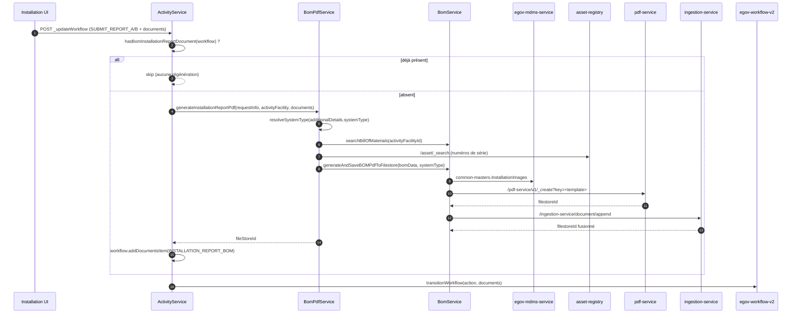

# Génération backend du rapport d'installation (PDF BOM)

Module concerné : `e4h-services/field-planner-activity`

---

## 1. Objectif

Le rapport d'installation (PDF) était auparavant construit côté frontend puis téléversé comme
document de workflow. Il est désormais **généré par le backend**, automatiquement, au moment où
l'installateur soumet son rapport.

Les changements apportés :

1. Génération automatique du PDF lors de la transition de workflow `SUBMIT_REPORT_A` /
   `SUBMIT_REPORT_B`, via la méthode `attachBomInstallationReportDocument`.
2. Idempotence : si le workflow porte déjà un document `INSTALLATION_REPORT_BOM`, aucun PDF n'est
   régénéré.
3. Construction des données du rapport (`BomPdfService`) : BOM, facility, boundaries localisées,
   numéros de série des assets, documents du workflow.
4. Sélection et ordonnancement des images d'installation **par type de système** (`systemType`), à
   partir du master MDMS `common-masters.InstallationImages`.
5. Concaténation en fin de PDF des documents annexes (`ASSET_HANDOVER_DOCUMENT`,
   `INSTALLATION_COMPLETION_CERTIFICATE`) via `ingestion-service`.

---

## 2. Vue d'ensemble du flux



---

## 3. Déclenchement

Fichier : [ActivityService.java:449](../../backend/e4h-services/field-planner-activity/src/main/java/org/egov/activity/service/ActivityService.java)

```java
// Le PDF doit être attaché AVANT l'appel de transition : c'est le seul endroit où les
// documents remontent vers workflow-v2.
if ("SUBMIT_REPORT_A".equalsIgnoreCase(action) || "SUBMIT_REPORT_B".equalsIgnoreCase(action)) {
    if (hasBomInstallationReportDocument(request.getWorkflow())) {
        // déjà généré lors d'une soumission précédente -> on ne régénère pas
    } else {
        attachBomInstallationReportDocument(request, existingActivityFacitlity);
    }
}
```

| Élément | Valeur |
|---|---|
| Actions déclenchantes | `SUBMIT_REPORT_A`, `SUBMIT_REPORT_B` (insensible à la casse) |
| Position dans le flux | Étape 1.5 — après la lecture de l'`ActivityFacility`, **avant** `transitionWorkflow` |
| Garde d'idempotence | `hasBomInstallationReportDocument(...)` : présence d'un document de type `INSTALLATION_REPORT_BOM` |
| Constante | `INSTALLATION_REPORT_BOM_DOCUMENT_TYPE = "INSTALLATION_REPORT_BOM"` |

---

## 4. `attachBomInstallationReportDocument`

Fichier : [ActivityService.java:552](../../backend/e4h-services/field-planner-activity/src/main/java/org/egov/activity/service/ActivityService.java)

```java
private void attachBomInstallationReportDocument(FacilityWorkflowRequest request, ActivityFacility activityFacility) {
    // Lu AVANT addDocumentsItem, pour que le rapport n'embarque jamais sa propre sortie précédente.
    List<Document> workflowDocuments = request.getWorkflow().getDocuments();

    String fileStoreId = bomPdfService.generateInstallationReportPdf(
            request.getRequestInfo(), activityFacility, workflowDocuments);

    AuditDetails auditDetails = activityServiceUtil.getAuditDetails(
            request.getRequestInfo().getUserInfo().getUuid(), null, true);

    Document pdfDocument = Document.builder()
            .documentType(INSTALLATION_REPORT_BOM_DOCUMENT_TYPE)
            .fileStoreId(fileStoreId)
            .documentUid("BOM-" + activityFacility.getId() + "-" + System.currentTimeMillis())
            .auditDetails(auditDetails)
            .build();

    request.getWorkflow().addDocumentsItem(pdfDocument);
}
```

Étapes :

| # | Étape | Détail |
|---|---|---|
| 1 | Capture des documents entrants | La liste est lue **avant** l'ajout du PDF : le rapport ne peut pas se contenir lui‑même |
| 2 | Génération | `BomPdfService.generateInstallationReportPdf(...)` → `fileStoreId` |
| 3 | Audit | `auditDetails` construits à partir de l'UUID de l'utilisateur appelant |
| 4 | Construction du `Document` | `documentType = INSTALLATION_REPORT_BOM`, `documentUid = BOM-<activityFacilityId>-<timestamp>` |
| 5 | Attachement | `workflow.addDocumentsItem(...)` — le document part avec la transition vers workflow‑v2 |

> Toute exception levée pendant la génération remonte : la transition de workflow n'a pas lieu et la
> soumission échoue. C'est volontaire — un rapport soumis sans PDF n'est pas exploitable en aval.

---

## 5. `BomPdfService.generateInstallationReportPdf`

Fichier : [BomPdfService.java](../../backend/e4h-services/field-planner-activity/src/main/java/org/egov/activity/service/BomPdfService.java)

```java
String systemType = resolveSystemType(activityFacility);                 // additionalDetails.systemType
BillOfMaterial bom = findBomForActivityFacility(...);                    // BOM de l'activity facility
Map<String, Object> bomData = buildBomData(...);                         // bom.data + entêtes rapport
bomData.put("documents", toPdfDocuments(workflowDocuments));             // images + annexes
bomData.putAll(buildSerialNumbersByAssetType(...));                      // numéros de série
return bomService.generateAndSaveBOMPdfToFilestore(pdfRequest, tenantId);
```

### 5.1 Résolution du `systemType`

Lu dans `activityFacility.additionalDetails.systemType`. Absent ou vide →
`CustomException("BOM_PDF_GENERATION_FAILED")` : sans lui, aucun template PDF ne peut être choisi
et aucune image ne peut être sélectionnée.

### 5.2 Champs injectés dans `bomData`

Base : `bom.getData()` (le formulaire BOM saisi), enrichi de :

| Clé | Source |
|---|---|
| `health_facility_name` | `facility.facilityName` |
| `health_facility_address` | `facility.address.addressLine1` |
| `health_facility_type` | `facility.facilityType` |
| `vendor_name` | `activityFacility.staffVendorName` |
| `project_number` | `fieldPlan.project.projectNumber` |
| `po_wo_number` | `fieldPlan.pocNumber` |
| `project_state` | `facility.boundary.state` **localisé** |
| `project_block` | `facility.boundary.block` **localisé** |
| `project_date` | date du jour, format `yyyy-MM-dd` |
| `documents` | documents du workflow retenus (voir 5.4) |
| `panel_serial_number` / `battery_serial_number` / `inverter_serial_number` | assets (voir 5.3) |
| `tenantId` | ajouté par `BomService.enrichBomData` (`"in"`) |

Les boundaries arrivent de `facility-service` sous forme de codes (`India_Assam_Darrang`) ; les deux
niveaux sont traduits en une seule requête via `BoundaryLocalizationUtil`. Si la localisation ne
renvoie rien, le code brut est conservé (`localizedNameOrCode`).

### 5.3 Numéros de série des assets

Recherche `asset-registry` `/v1/asset/_search?offset=0&limit=${egov.asset.search.limit}` (limite
explicite : le service plafonne à 10 par défaut, ce qui tronquerait silencieusement la liste).

Regroupement par `assetTypeID` :

| `assetTypeID` | Clé `bomData` |
|---|---|
| `PANEL` | `panel_serial_number` |
| `BATTERY` | `battery_serial_number` |
| `INVERTER` | `inverter_serial_number` |

Chaque clé est **toujours** émise (liste vide si aucun asset), au format
`[{ "srNo": 1, "serialNumber": "..." }, ...]` — `srNo` repart à 1 pour chaque type. Un échec de
l'appel `asset-registry` fait échouer la génération (`BOM_PDF_GENERATION_FAILED`).

### 5.4 Documents retenus

`toPdfDocuments` filtre les documents du workflow et les aplatit en `Map` brutes
(`documentType` / `fileStoreId`) — pas des POJO `Document`, car `BomService.enrichBomData` les relit
comme `List<Map<String, Object>>`.

Sont retenus :

- tous les documents dont le `documentType` contient `INSTALLATION_IMAGE-` (rendus **dans** le PDF) ;
- `ASSET_HANDOVER_DOCUMENT` et `INSTALLATION_COMPLETION_CERTIFICATE` (concaténés **à la fin** du PDF).

Les entrées sans `fileStoreId` sont ignorées.

---

## 6. `BomService.generateAndSaveBOMPdfToFilestore`

Fichier : [BomService.java](../../backend/e4h-services/field-planner-activity/src/main/java/org/egov/activity/service/BomService.java)

```java
String pdfKey = startupRunner.getConfigMap().get(systemType);   // template pdf-service
if (pdfKey == null) throw new CustomException("BOM_PDF", "Unknown System Type: " + systemType);

// AVANT enrichBomData, qui écrase bom.documents par les seules images groupées
List<Map<String, Object>> documentsToAppend = extractAppendableDocuments(request.getBomData());

enrichBomData(request);                                          // images groupées + tenantId
String pdfFilestoreId = uploadBOMPdfFilestore(pdfKey, tenantId, request);
return appendBomDocumentsToPdf(pdfFilestoreId, tenantId, documentsToAppend);
```

### 6.1 Choix du template (`StartupRunner`)

| `systemType` | Propriété | Clé pdf-service |
|---|---|---|
| `DC` | `egov.dc.system.key` | `dc_system_2_0` |
| `AC_ON_GRID_SINGLE_PHASE` | `egov.on.grid.single.phase.key` | `ac_on_grid_rms_single_phase` |
| `AC_ON_GRID_THREE_PHASE` | `egov.on.grid.three.phase.key` | `ac_on_grid_rms_three_phase` |
| `AC_OFF_GRID` | `egov.off.grid.single.phase.key` | `ac_off_grid_rms_single_phase` |
| `AC_OFF_GRID_THREE_PHASE` | `egov.off.grid.three.phase.key` | `ac_off_grid_rms_three_phase` |
| `HYBRID_SINGLE_PHASE` | `egov.hybrid.single.phase.key` | `ac_hybrid_rms_single_phase` |
| `HYBRID_THREE_PHASE` | `egov.hybrid.three.phase.key` | `ac_hybrid_rms_three_phase` |

Un `systemType` inconnu de cette map → `CustomException("BOM_PDF", "Unknown System Type: ...")`.

### 6.2 `enrichBomData` — regroupement des images par code

Pour chaque image **exigée par le type de système**, une entrée `BomPdfDocument` est produite :

```json
{
  "documentType": "INSTALLATION_IMAGE-5",
  "documentName": "Clear image of cable routing for the entire system (Please capture image with standard marking)",
  "fileStoreIds": ["fs-1", "fs-2", "fs-3"]
}
```

- `documentType` = `INSTALLATION_IMAGE-` + `code` du master ;
- `documentName` = `description` du master ;
- `fileStoreIds` = tous les `fileStoreId` des uploads portant ce `documentType`.

L'entrée est **toujours** émise, même sans upload correspondant (`fileStoreIds` vide) : le titre de
section apparaît alors dans le rapport sans image. `bom.documents` est ensuite écrasé par cette liste
groupée et ordonnée.

### 6.3 Sélection et ordre — `installationImagesForSystem`

```java
allImages.stream()
    .filter(image -> !Boolean.FALSE.equals(image.getActive()))
    .filter(image -> image.getOrderBySystemType().containsKey(systemType))
    .sorted(Comparator.comparingDouble(image -> image.getOrderBySystemType().get(systemType)))
```

Règles :

- une image dont `system_types` ne liste pas le `systemType` **n'est pas rendue du tout** (un rapport
  `AC_ON_GRID_THREE_PHASE` ne doit pas porter les sections spécifiques au DC) ;
- l'ordre du rapport est celui déclaré par le `systemType`, **pas** l'ordre du tableau MDMS ;
- `active: false` exclut l'entrée ;
- aucune image trouvée pour le `systemType` → `log.warn` (non bloquant, mais signale une dérive entre
  le master et les codes de type de système).

### 6.4 Appels sortants

| Appel | URL | Rôle |
|---|---|---|
| pdf-service | `POST {egov.pdf.host}/pdf-service/v1/_create?key=<pdfKey>&tenantId=<tenantId>` | génère le PDF et le stocke → `filestoreIds[0]` |
| ingestion-service | `POST {egov.ingestion.host}/ingestion-service/document/append` | concatène les annexes → `fileStoreId` fusionné |

Payload d'append :

```json
{
  "tenantId": "in",
  "module": "activity-bom",
  "parentFileStoreId": "<pdf généré>",
  "documents": [ { "documentType": "ASSET_HANDOVER_DOCUMENT", "fileStoreId": "..." } ]
}
```

Les annexes sont ordonnées **par type** (`ASSET_HANDOVER_DOCUMENT` puis
`INSTALLATION_COMPLETION_CERTIFICATE`), pas par ordre d'arrivée. S'il n'y a aucune annexe, le
`fileStoreId` du PDF d'origine est retourné tel quel.

---

## 7. Master MDMS `common-masters.InstallationImages`

Lecture : `POST {egov.mdms.host}/egov-mdms-service/v1/_search`, module `common-masters`, master
`InstallationImages`, tenant `in` — voir `MDMSUtils.fetchInstallationImages`.
Le backend lit `masterRecords[0].InstallationImage[]`.

### 7.1 Schéma (`InstallationImagesSchema.json`)

```jsonc
{
  "code": "string",              // identifiant de l'image -> documentType INSTALLATION_IMAGE-<code>
  "short_title": "string",       // titre court (UI)
  "description": "string",       // libellé rendu dans le PDF (documentName)
  "required_count": "number",    // nombre de photos attendues (UI)
  "active": "boolean",
  "system_types": [              // types de système concernés + ordre dans le rapport
    { "code": "DC", "order": 1 }
  ]
}
```

Champs `required` du schéma : `code`, `short_title`, `description`, `required_count`,
`system_types` (min. 1 élément, unique), `active`. `additionalProperties: false` aux deux niveaux.

### 7.2 Champs réellement consommés

| Champ | Backend (PDF) | Frontend (PM / QC) |
|---|---|---|
| `code` | ✅ `documentType` | ✅ clé d'upload |
| `description` | ✅ `documentName` dans le PDF | ✅ consigne de prise de vue |
| `active` | ✅ filtre | — |
| `system_types[].code` | ✅ filtre | ✅ filtre |
| `system_types[].order` | ✅ tri | ✅ tri |
| `short_title` | ❌ non lu | ✅ titre de section |
| `required_count` | ❌ non lu | ✅ nombre de photos exigées |

`InstallationImageMaster` (backend) aplatit `system_types` en `Map<String, Double> orderBySystemType`.
Les `order` sont fractionnaires dans le master (`14.1`, `14.2`, `16.3`) → typés `Double`. Un `order`
absent ou non numérique trie en dernier plutôt que d'exclure l'image. Une entrée sans `code` ou sans
`description` est ignorée.

Le frontend applique la même règle
(`packages/modules/{pm,qc}/src/utilities/installationImages.js`) : filtre sur `system_types[].code`
puis tri sur `order`. Backend et frontend doivent donc rester alignés sur le même master.

### 7.3 Répartition des données actuelles (`InstallationImages.json`, 46 entrées)

| `systemType` | Sections rendues | Total photos attendues (`required_count`) |
|---|---|---|
| `DC` | 11 | 17 |
| `AC_ON_GRID_SINGLE_PHASE` | 27 | 32 |
| `AC_ON_GRID_THREE_PHASE` | 27 | 32 |
| `AC_OFF_GRID` | 17 | 22 |
| `AC_OFF_GRID_THREE_PHASE` | 17 | 22 |
| `HYBRID_SINGLE_PHASE` | 29 | 34 |
| `HYBRID_THREE_PHASE` | 29 | 34 |

Exemple — ordre du rapport `DC` :

| Ordre | `code` | `short_title` | `required_count` |
|---|---|---|---|
| 1 | 1 | Solar Panels & Mounting Structure | 2 |
| 2 | 2 | Batteries | 1 |
| 3 | 3 | CCU Front & Back | 2 |
| 4 | 4 | CCU Isolator Switches | 1 |
| 5 | 5 | Cable Routing | 3 |
| 6 | 6 | DO's & Don'ts Poster | 1 |
| 7 | 7 | Foam Plaques | 2 |
| 8 | 8 | Metal Plaque | 1 |
| 9 | 9 | Connected Loads | 2 |
| 10 | 10 | Health Centre - Long Shot | 1 |
| 11 | 11 | Health Staff with Solar System | 1 |

Les codes `21`/`22`/`23` (tensions) et `27`/`28` (isolateurs) utilisent des ordres fractionnaires
(`14.1`, `14.2`, `14.3`, `18.1`, `18.2`) pour rester groupés sous une même rubrique.

---

## 8. Configuration

```properties
# pdf-service
egov.pdf.host=http://localhost:8096
egov.createandsave.pdf.url=/pdf-service/v1/_create
egov.createnosave.pdf.url=/pdf-service/v1/_createnosave

# templates par type de système
egov.dc.system.key=dc_system_2_0
egov.on.grid.single.phase.key=ac_on_grid_rms_single_phase
egov.on.grid.three.phase.key=ac_on_grid_rms_three_phase
egov.off.grid.single.phase.key=ac_off_grid_rms_single_phase
egov.off.grid.three.phase.key=ac_off_grid_rms_three_phase
egov.hybrid.single.phase.key=ac_hybrid_rms_single_phase
egov.hybrid.three.phase.key=ac_hybrid_rms_three_phase

# concaténation des annexes
egov.ingestion.host=http://localhost:8080
egov.ingestion.document.append.url=/ingestion-service/document/append
egov.ingestion.document.append.module=activity-bom

# assets (numéros de série)
egov.asset.host=http://localhost:8086
egov.asset.search.url=/asset-registry/v1/asset/_search
egov.asset.search.limit=1000

# mdms
egov.mdms.host=http://localhost:8285
egov.mdms.search.endpoint=/egov-mdms-service/v1/_search
```

---

## 9. Codes d'erreur

| Code | Levé par | Cause |
|---|---|---|
| `BOM_PDF_GENERATION_FAILED` | `BomPdfService.resolveSystemType` | `systemType` absent de `additionalDetails` |
| `BOM_PDF_GENERATION_FAILED` | `BomPdfService.findBomForActivityFacility` | aucun BOM pour l'`activityFacilityId` |
| `BOM_PDF_GENERATION_FAILED` | `BomPdfService.searchAssets` | échec de l'appel `asset-registry` |
| `BOM_PDF` | `BomService` | `systemType` nul ou inconnu de la config des templates |
| `ERROR_PDF_GENERATION` | `BomService.uploadBOMPdfFilestore` | pdf-service ne renvoie aucun `filestoreId` |
| `ERROR_PDF_DOCUMENT_APPEND` | `BomService.appendBomDocumentsToPdf` | ingestion-service ne renvoie aucun `fileStoreId` |
| `MDMS_ERROR` | `MDMSUtils.fetchInstallationImages` | échec de lecture du master `InstallationImages` |
| `WORKFLOW_TRANSITION_FAILED` | `ActivityService` | échec de la transition (après génération du PDF) |

---

## 10. Points d'attention

- **Prérequis de déploiement** : les 7 templates pdf-service doivent exister sous les clés
  configurées, et le master `common-masters.InstallationImages` doit être chargé pour le tenant `in`,
  sinon toute soumission de rapport échoue.
- **Cohérence des codes** : `system_types[].code` du master doit correspondre exactement aux codes de
  `facility.SystemType` (et aux clés de `StartupRunner`). Une dérive se traduit par un rapport sans
  image et un simple `log.warn`.
- **`required_count` n'est pas vérifié côté backend** : le nombre de photos exigé n'est contrôlé que
  par l'UI. Le PDF est généré même s'il manque des photos (section avec `fileStoreIds` vide).
- **Aucun cache MDMS** : `fetchInstallationImages` appelle MDMS à chaque génération.
- **Re-soumission** : après un rejet, si le frontend renvoie le document `INSTALLATION_REPORT_BOM`
  précédent dans le workflow, l'ancien PDF est conservé tel quel. Pour forcer une régénération avec
  les nouvelles photos, ce document ne doit **pas** être renvoyé.
- **Actions `APPROVE`** : la génération ne s'exécute qu'aux actions `SUBMIT_REPORT_A` /
  `SUBMIT_REPORT_B` ; l'approbation déclenche seulement les effets de bord (assets, AMC, ONM ready).

---

## 11. Fichiers de référence

| Fichier | Rôle |
|---|---|
| `service/ActivityService.java` | déclenchement, `hasBomInstallationReportDocument`, `attachBomInstallationReportDocument` |
| `service/BomPdfService.java` | construction de `bomData`, systemType, assets, documents |
| `service/BomService.java` | template, `enrichBomData`, appel pdf-service, append des annexes |
| `util/MDMSUtils.java` | `fetchInstallationImages`, mapping `system_types` → `orderBySystemType` |
| `util/BoundaryLocalizationUtil.java` | localisation des codes de boundary (state / block) |
| `util/StartupRunner.java` | map `systemType` → clé de template pdf-service |
| `util/ActivityConstants.java` | `MASTER_INSTALLATION_IMAGES`, `INSTALLATION_IMAGE_DOCUMENT_TYPE_PREFIX`, … |
| `web/models/InstallationImageMaster.java` | entrée du master MDMS |
| `web/models/BomPdfDocument.java` | entrée groupée envoyée au template PDF |
| `web/models/GenerateBOMPdfRequest.java` | payload pdf-service (`RequestInfo`, `system`, `bom`) |

Frontend correspondant :
`frontend/installation-ui/.../packages/modules/{pm,qc}/src/utilities/installationImages.js`

---

## 12. Historique

| Commit | Contenu |
|---|---|
| `abfb12a51` | première version : `BomPdfService`, `BoundaryLocalizationUtil`, accroche dans `ActivityService` |
| `9a4530eb5`, `98cc526a3`, `e8d312146` | numéros de série des assets, documents du workflow, append des annexes, idempotence |
| `7b6dd87c0` | sélection et ordre des images par `systemType` via MDMS (`InstallationImageMaster`) |
| `841ff032c` | alignement frontend (PM / QC) sur `system_types` |
