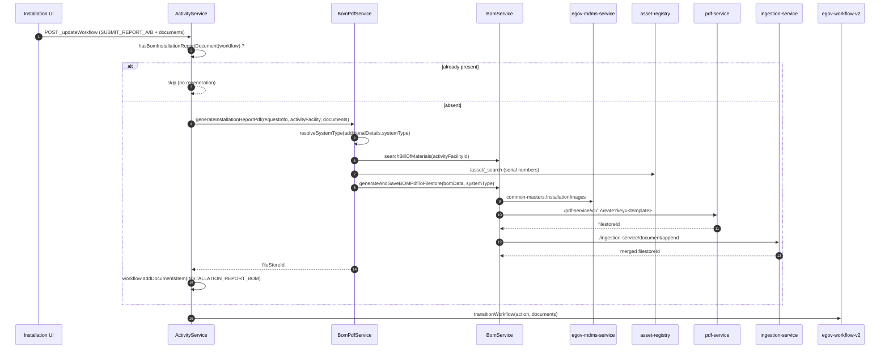

# Backend Generation of the Installation Report (BOM PDF)

Module: `e4h-services/field-planner-activity`

---

## 1. Objective

The installation report PDF used to be built on the frontend and uploaded as a workflow document. It
is now **generated by the backend**, automatically, at the moment the installer submits the report.

What changed:

1. Automatic PDF generation on the `SUBMIT_REPORT_A` / `SUBMIT_REPORT_B` workflow transitions,
   through `attachBomInstallationReportDocument`.
2. Idempotency: if the workflow already carries an `INSTALLATION_REPORT_BOM` document, no PDF is
   regenerated.
3. Report data assembly (`BomPdfService`): BOM, facility, localized boundaries, asset serial numbers,
   workflow documents.
4. Selection and ordering of installation images **per system type** (`systemType`), driven by the
   MDMS master `common-masters.InstallationImages`.
5. Appending of the annex documents (`ASSET_HANDOVER_DOCUMENT`,
   `INSTALLATION_COMPLETION_CERTIFICATE`) to the end of the PDF through `ingestion-service`.

---

## 2. Flow Overview



---

## 3. Trigger

File: [ActivityService.java:449](../../backend/e4h-services/field-planner-activity/src/main/java/org/egov/activity/service/ActivityService.java)

```java
// The PDF must be attached BEFORE the transition call: that call is the only place where
// documents travel to workflow-v2.
if ("SUBMIT_REPORT_A".equalsIgnoreCase(action) || "SUBMIT_REPORT_B".equalsIgnoreCase(action)) {
    if (hasBomInstallationReportDocument(request.getWorkflow())) {
        // already generated on an earlier submission -> do not regenerate
    } else {
        attachBomInstallationReportDocument(request, existingActivityFacitlity);
    }
}
```

| Item | Value |
|---|---|
| Triggering actions | `SUBMIT_REPORT_A`, `SUBMIT_REPORT_B` (case-insensitive) |
| Position in the flow | Step 1.5 — after the `ActivityFacility` is read, **before** `transitionWorkflow` |
| Idempotency guard | `hasBomInstallationReportDocument(...)`: presence of an `INSTALLATION_REPORT_BOM` document |
| Constant | `INSTALLATION_REPORT_BOM_DOCUMENT_TYPE = "INSTALLATION_REPORT_BOM"` |

---

## 4. `attachBomInstallationReportDocument`

File: [ActivityService.java:552](../../backend/e4h-services/field-planner-activity/src/main/java/org/egov/activity/service/ActivityService.java)

```java
private void attachBomInstallationReportDocument(FacilityWorkflowRequest request, ActivityFacility activityFacility) {
    // Read BEFORE addDocumentsItem, so the report never carries its own previous output.
    List<Document> workflowDocuments = request.getWorkflow().getDocuments();

    String fileStoreId = bomPdfService.generateInstallationReportPdf(
            request.getRequestInfo(), activityFacility, workflowDocuments);

    AuditDetails auditDetails = activityServiceUtil.getAuditDetails(
            request.getRequestInfo().getUserInfo().getUuid(), null, true);

    Document pdfDocument = Document.builder()
            .documentType(INSTALLATION_REPORT_BOM_DOCUMENT_TYPE)
            .fileStoreId(fileStoreId)
            .documentUid("BOM-" + activityFacility.getId() + "-" + System.currentTimeMillis())
            .auditDetails(auditDetails)
            .build();

    request.getWorkflow().addDocumentsItem(pdfDocument);
}
```

Steps:

| # | Step | Detail |
|---|---|---|
| 1 | Capture the incoming documents | The list is read **before** the PDF is added: the report cannot contain itself |
| 2 | Generate | `BomPdfService.generateInstallationReportPdf(...)` → `fileStoreId` |
| 3 | Audit | `auditDetails` built from the calling user's UUID |
| 4 | Build the `Document` | `documentType = INSTALLATION_REPORT_BOM`, `documentUid = BOM-<activityFacilityId>-<timestamp>` |
| 5 | Attach | `workflow.addDocumentsItem(...)` — the document travels with the transition to workflow-v2 |

> Any exception raised during generation propagates: the workflow transition does not happen and the
> submission fails. That is deliberate — a report submitted without its PDF is unusable downstream.

---

## 5. `BomPdfService.generateInstallationReportPdf`

File: [BomPdfService.java](../../backend/e4h-services/field-planner-activity/src/main/java/org/egov/activity/service/BomPdfService.java)

```java
String systemType = resolveSystemType(activityFacility);                 // additionalDetails.systemType
BillOfMaterial bom = findBomForActivityFacility(...);                    // BOM of the activity facility
Map<String, Object> bomData = buildBomData(...);                         // bom.data + report header fields
bomData.put("documents", toPdfDocuments(workflowDocuments));             // images + annexes
bomData.putAll(buildSerialNumbersByAssetType(...));                      // serial numbers
return bomService.generateAndSaveBOMPdfToFilestore(pdfRequest, tenantId);
```

### 5.1 Resolving `systemType`

Read from `activityFacility.additionalDetails.systemType`. Missing or blank →
`CustomException("BOM_PDF_GENERATION_FAILED")`: without it no PDF template can be selected and no
image can be picked.

### 5.2 Fields injected into `bomData`

Base: `bom.getData()` (the captured BOM form), enriched with:

| Key | Source |
|---|---|
| `health_facility_name` | `facility.facilityName` |
| `health_facility_address` | `facility.address.addressLine1` |
| `health_facility_type` | `facility.facilityType` |
| `vendor_name` | `activityFacility.staffVendorName` |
| `project_number` | `fieldPlan.project.projectNumber` |
| `po_wo_number` | `fieldPlan.pocNumber` |
| `project_state` | `facility.boundary.state`, **localized** |
| `project_block` | `facility.boundary.block`, **localized** |
| `project_date` | current date, `yyyy-MM-dd` |
| `documents` | retained workflow documents (see 5.4) |
| `panel_serial_number` / `battery_serial_number` / `inverter_serial_number` | assets (see 5.3) |
| `tenantId` | added by `BomService.enrichBomData` (`"in"`) |

Boundaries come back from `facility-service` as codes (`India_Assam_Darrang`); both levels are
translated in a single call through `BoundaryLocalizationUtil`. If localization returns nothing, the
raw code is kept (`localizedNameOrCode`).

### 5.3 Asset serial numbers

`asset-registry` search `/v1/asset/_search?offset=0&limit=${egov.asset.search.limit}` — the limit is
sent explicitly because the service defaults to 10, which would silently drop serial numbers.

Grouped by `assetTypeID`:

| `assetTypeID` | `bomData` key |
|---|---|
| `PANEL` | `panel_serial_number` |
| `BATTERY` | `battery_serial_number` |
| `INVERTER` | `inverter_serial_number` |

Every key is **always** emitted (empty list when the facility has no such asset), shaped as
`[{ "srNo": 1, "serialNumber": "..." }, ...]` — `srNo` restarts at 1 per type. A failing
`asset-registry` call fails the whole generation (`BOM_PDF_GENERATION_FAILED`).

### 5.4 Retained documents

`toPdfDocuments` filters the workflow documents and flattens them into plain `Map`s
(`documentType` / `fileStoreId`) — not `Document` POJOs, because `BomService.enrichBomData` reads
them back as `List<Map<String, Object>>`.

Retained:

- every document whose `documentType` contains `INSTALLATION_IMAGE-` (rendered **inside** the PDF);
- `ASSET_HANDOVER_DOCUMENT` and `INSTALLATION_COMPLETION_CERTIFICATE` (appended **at the end** of the
  PDF).

Entries without a `fileStoreId` are dropped.

---

## 6. `BomService.generateAndSaveBOMPdfToFilestore`

File: [BomService.java](../../backend/e4h-services/field-planner-activity/src/main/java/org/egov/activity/service/BomService.java)

```java
String pdfKey = startupRunner.getConfigMap().get(systemType);   // pdf-service template
if (pdfKey == null) throw new CustomException("BOM_PDF", "Unknown System Type: " + systemType);

// BEFORE enrichBomData, which overwrites bom.documents with only the grouped images
List<Map<String, Object>> documentsToAppend = extractAppendableDocuments(request.getBomData());

enrichBomData(request);                                          // grouped images + tenantId
String pdfFilestoreId = uploadBOMPdfFilestore(pdfKey, tenantId, request);
return appendBomDocumentsToPdf(pdfFilestoreId, tenantId, documentsToAppend);
```

### 6.1 Template selection (`StartupRunner`)

| `systemType` | Property | pdf-service key |
|---|---|---|
| `DC` | `egov.dc.system.key` | `dc_system_2_0` |
| `AC_ON_GRID_SINGLE_PHASE` | `egov.on.grid.single.phase.key` | `ac_on_grid_rms_single_phase` |
| `AC_ON_GRID_THREE_PHASE` | `egov.on.grid.three.phase.key` | `ac_on_grid_rms_three_phase` |
| `AC_OFF_GRID` | `egov.off.grid.single.phase.key` | `ac_off_grid_rms_single_phase` |
| `AC_OFF_GRID_THREE_PHASE` | `egov.off.grid.three.phase.key` | `ac_off_grid_rms_three_phase` |
| `HYBRID_SINGLE_PHASE` | `egov.hybrid.single.phase.key` | `ac_hybrid_rms_single_phase` |
| `HYBRID_THREE_PHASE` | `egov.hybrid.three.phase.key` | `ac_hybrid_rms_three_phase` |

A `systemType` missing from this map → `CustomException("BOM_PDF", "Unknown System Type: ...")`.

### 6.2 `enrichBomData` — grouping images by code

For every image **required by the system type**, one `BomPdfDocument` entry is produced:

```json
{
  "documentType": "INSTALLATION_IMAGE-5",
  "documentName": "Clear image of cable routing for the entire system (Please capture image with standard marking)",
  "fileStoreIds": ["fs-1", "fs-2", "fs-3"]
}
```

- `documentType` = `INSTALLATION_IMAGE-` + the master's `code`;
- `documentName` = the master's `description`;
- `fileStoreIds` = every `fileStoreId` of the uploads carrying that `documentType`.

The entry is **always** emitted, even with no matching upload (`fileStoreIds` empty): the section
title then appears in the report without an image. `bom.documents` is finally overwritten with this
grouped, ordered list.

### 6.3 Selection and ordering — `installationImagesForSystem`

```java
allImages.stream()
    .filter(image -> !Boolean.FALSE.equals(image.getActive()))
    .filter(image -> image.getOrderBySystemType().containsKey(systemType))
    .sorted(Comparator.comparingDouble(image -> image.getOrderBySystemType().get(systemType)))
```

Rules:

- an image whose `system_types` does not list the `systemType` is **not rendered at all** (an
  `AC_ON_GRID_THREE_PHASE` report must not carry the DC-only sections);
- the report order is the one declared by the system type, **not** the MDMS array order;
- `active: false` excludes the entry;
- no image found for the system type → `log.warn` (non-blocking, but it always means the master and
  the system type codes have drifted apart).

### 6.4 Outbound calls

| Call | URL | Role |
|---|---|---|
| pdf-service | `POST {egov.pdf.host}/pdf-service/v1/_create?key=<pdfKey>&tenantId=<tenantId>` | generates and stores the PDF → `filestoreIds[0]` |
| ingestion-service | `POST {egov.ingestion.host}/ingestion-service/document/append` | appends the annexes → merged `fileStoreId` |

Append payload:

```json
{
  "tenantId": "in",
  "module": "activity-bom",
  "parentFileStoreId": "<generated pdf>",
  "documents": [ { "documentType": "ASSET_HANDOVER_DOCUMENT", "fileStoreId": "..." } ]
}
```

Annexes are ordered **by type** (`ASSET_HANDOVER_DOCUMENT` first, then
`INSTALLATION_COMPLETION_CERTIFICATE`), not by arrival order. When there is no annex, the original
PDF `fileStoreId` is returned unchanged.

---

## 7. MDMS master `common-masters.InstallationImages`

Read through `POST {egov.mdms.host}/egov-mdms-service/v1/_search`, module `common-masters`, master
`InstallationImages`, tenant `in` — see `MDMSUtils.fetchInstallationImages`. The backend reads
`masterRecords[0].InstallationImage[]`.

### 7.1 Schema (`InstallationImagesSchema.json`)

```jsonc
{
  "code": "string",              // image identifier -> documentType INSTALLATION_IMAGE-<code>
  "short_title": "string",       // short title (UI)
  "description": "string",       // label rendered in the PDF (documentName)
  "required_count": "number",    // number of photos expected (UI)
  "active": "boolean",
  "system_types": [              // system types concerned + order within the report
    { "code": "DC", "order": 1 }
  ]
}
```

Schema `required` fields: `code`, `short_title`, `description`, `required_count`, `system_types`
(min. 1 item, unique) and `active`. `additionalProperties: false` at both levels.

### 7.2 Fields actually consumed

| Field | Backend (PDF) | Frontend (PM / QC) |
|---|---|---|
| `code` | ✅ `documentType` | ✅ upload key |
| `description` | ✅ `documentName` in the PDF | ✅ capture instruction |
| `active` | ✅ filter | — |
| `system_types[].code` | ✅ filter | ✅ filter |
| `system_types[].order` | ✅ sort | ✅ sort |
| `short_title` | ❌ not read | ✅ section title |
| `required_count` | ❌ not read | ✅ number of photos required |

`InstallationImageMaster` (backend) flattens `system_types` into `Map<String, Double>
orderBySystemType`. Orders are fractional in the master (`14.1`, `14.2`, `16.3`), hence `Double`. A
missing or non-numeric `order` sorts last rather than dropping the image. An entry without a `code`
or a `description` is skipped.

The frontend applies the same rule
(`packages/modules/{pm,qc}/src/utilities/installationImages.js`): filter on `system_types[].code`,
then sort on `order`. Backend and frontend must therefore stay aligned on the same master.

### 7.3 Current data breakdown (`InstallationImages.json`, 46 entries)

| `systemType` | Sections rendered | Total photos expected (`required_count`) |
|---|---|---|
| `DC` | 11 | 17 |
| `AC_ON_GRID_SINGLE_PHASE` | 27 | 32 |
| `AC_ON_GRID_THREE_PHASE` | 27 | 32 |
| `AC_OFF_GRID` | 17 | 22 |
| `AC_OFF_GRID_THREE_PHASE` | 17 | 22 |
| `HYBRID_SINGLE_PHASE` | 29 | 34 |
| `HYBRID_THREE_PHASE` | 29 | 34 |

Example — `DC` report order:

| Order | `code` | `short_title` | `required_count` |
|---|---|---|---|
| 1 | 1 | Solar Panels & Mounting Structure | 2 |
| 2 | 2 | Batteries | 1 |
| 3 | 3 | CCU Front & Back | 2 |
| 4 | 4 | CCU Isolator Switches | 1 |
| 5 | 5 | Cable Routing | 3 |
| 6 | 6 | DO's & Don'ts Poster | 1 |
| 7 | 7 | Foam Plaques | 2 |
| 8 | 8 | Metal Plaque | 1 |
| 9 | 9 | Connected Loads | 2 |
| 10 | 10 | Health Centre - Long Shot | 1 |
| 11 | 11 | Health Staff with Solar System | 1 |

Codes `21`/`22`/`23` (voltages) and `27`/`28` (isolators) use fractional orders (`14.1`, `14.2`,
`14.3`, `18.1`, `18.2`) so they stay grouped under a single heading.

---

## 8. Configuration

```properties
# pdf-service
egov.pdf.host=http://localhost:8096
egov.createandsave.pdf.url=/pdf-service/v1/_create
egov.createnosave.pdf.url=/pdf-service/v1/_createnosave

# templates per system type
egov.dc.system.key=dc_system_2_0
egov.on.grid.single.phase.key=ac_on_grid_rms_single_phase
egov.on.grid.three.phase.key=ac_on_grid_rms_three_phase
egov.off.grid.single.phase.key=ac_off_grid_rms_single_phase
egov.off.grid.three.phase.key=ac_off_grid_rms_three_phase
egov.hybrid.single.phase.key=ac_hybrid_rms_single_phase
egov.hybrid.three.phase.key=ac_hybrid_rms_three_phase

# annex appending
egov.ingestion.host=http://localhost:8080
egov.ingestion.document.append.url=/ingestion-service/document/append
egov.ingestion.document.append.module=activity-bom

# assets (serial numbers)
egov.asset.host=http://localhost:8086
egov.asset.search.url=/asset-registry/v1/asset/_search
egov.asset.search.limit=1000

# mdms
egov.mdms.host=http://localhost:8285
egov.mdms.search.endpoint=/egov-mdms-service/v1/_search
```

---

## 9. Error codes

| Code | Raised by | Cause |
|---|---|---|
| `BOM_PDF_GENERATION_FAILED` | `BomPdfService.resolveSystemType` | `systemType` missing from `additionalDetails` |
| `BOM_PDF_GENERATION_FAILED` | `BomPdfService.findBomForActivityFacility` | no BOM for the `activityFacilityId` |
| `BOM_PDF_GENERATION_FAILED` | `BomPdfService.searchAssets` | `asset-registry` call failed |
| `BOM_PDF` | `BomService` | `systemType` null or unknown to the template config |
| `ERROR_PDF_GENERATION` | `BomService.uploadBOMPdfFilestore` | pdf-service returned no `filestoreId` |
| `ERROR_PDF_DOCUMENT_APPEND` | `BomService.appendBomDocumentsToPdf` | ingestion-service returned no `fileStoreId` |
| `MDMS_ERROR` | `MDMSUtils.fetchInstallationImages` | failed to read the `InstallationImages` master |
| `WORKFLOW_TRANSITION_FAILED` | `ActivityService` | transition failed (after the PDF was generated) |

---

## 10. Things to watch

- **Deployment prerequisites**: the 7 pdf-service templates must exist under the configured keys, and
  the `common-masters.InstallationImages` master must be loaded for tenant `in` — otherwise every
  report submission fails.
- **Code consistency**: `system_types[].code` in the master must match the `facility.SystemType` codes
  exactly (and the `StartupRunner` keys). Any drift produces an image-less report and only a
  `log.warn`.
- **`required_count` is not enforced by the backend**: the expected number of photos is only checked
  by the UI. The PDF is generated even when photos are missing (section with empty `fileStoreIds`).
- **No MDMS caching**: `fetchInstallationImages` calls MDMS on every generation.
- **Re-submission**: after a rejection, if the frontend sends back the previous
  `INSTALLATION_REPORT_BOM` document in the workflow, the old PDF is kept as-is. To force a
  regeneration with the new photos, that document must **not** be sent back.
- **`APPROVE` actions**: generation only runs on `SUBMIT_REPORT_A` / `SUBMIT_REPORT_B`; approval only
  triggers the side effects (assets, AMC, ONM ready).

---

## 11. Reference files

| File | Role |
|---|---|
| `service/ActivityService.java` | trigger, `hasBomInstallationReportDocument`, `attachBomInstallationReportDocument` |
| `service/BomPdfService.java` | `bomData` assembly, systemType, assets, documents |
| `service/BomService.java` | template, `enrichBomData`, pdf-service call, annex appending |
| `util/MDMSUtils.java` | `fetchInstallationImages`, `system_types` → `orderBySystemType` mapping |
| `util/BoundaryLocalizationUtil.java` | boundary code localization (state / block) |
| `util/StartupRunner.java` | `systemType` → pdf-service template key map |
| `util/ActivityConstants.java` | `MASTER_INSTALLATION_IMAGES`, `INSTALLATION_IMAGE_DOCUMENT_TYPE_PREFIX`, … |
| `web/models/InstallationImageMaster.java` | one MDMS master entry |
| `web/models/BomPdfDocument.java` | grouped entry sent to the PDF template |
| `web/models/GenerateBOMPdfRequest.java` | pdf-service payload (`RequestInfo`, `system`, `bom`) |

Matching frontend:
`frontend/installation-ui/.../packages/modules/{pm,qc}/src/utilities/installationImages.js`

---

## 12. History

| Commit | Content |
|---|---|
| `abfb12a51` | first version: `BomPdfService`, `BoundaryLocalizationUtil`, hook in `ActivityService` |
| `9a4530eb5`, `98cc526a3`, `e8d312146` | asset serial numbers, workflow documents, annex appending, idempotency |
| `7b6dd87c0` | image selection and ordering per `systemType` through MDMS (`InstallationImageMaster`) |
| `841ff032c` | frontend alignment (PM / QC) on `system_types` |
