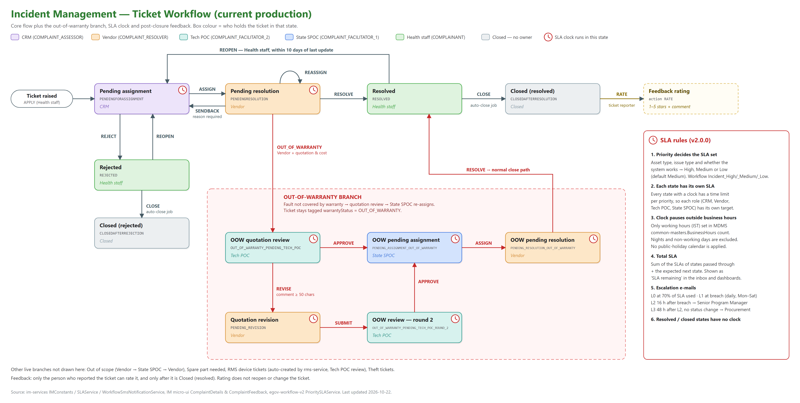

# Incident Management Workflow — v2.0.0 update

This page updates the existing Incident Management (IM) workflow documentation. That documentation covers the state diagram, the 7-state transition table, SLA config, the workflow JSON, and the re-open, send-back and auto-close flows. Everything in it still holds. This page adds three things that are live in production but were not documented:

1. **SLA rules:** priority-based SLA, the clock pausing outside business hours, and SLA per role.
2. **Out-of-warranty branch:** Vendor flags a ticket, Tech POC reviews the quotation, State SPOC re-assigns.
3. **Feedback rating:** collected after a ticket is closed.

## Who is who

| In this guide | System role code | What they do in the workflow |
|---|---|---|
| Health staff | `COMPLAINANT` | Raises the ticket, reopens it if the fix did not work, gives feedback |
| CRM | `COMPLAINT_ASSESSOR` | Assigns new tickets to a vendor, or rejects them |
| Vendor | `COMPLAINT_RESOLVER` | Fixes the issue, or flags it as out of warranty |
| Tech POC | `COMPLAINT_FACILITATOR_2` | Reviews out-of-warranty quotations |
| State SPOC | `COMPLAINT_FACILITATOR_1` | Re-assigns approved out-of-warranty tickets |
| System | `SYSTEM` / `AUTO_ESCALATE` | Auto-closes tickets and runs scheduled jobs |

## Updated state transition table

Actions are taken by whoever holds the ticket in the "From" state, unless the table says otherwise. Rows marked **New** are the additions in this update.

The **SLA clock** column says what the clock does once the ticket reaches the "To" state, and whose time it measures. See section 1, SLA rules.

| # | From state | Action | By | To state | SLA clock | Notes |
|---|---|---|---|---|---|---|
| 1 | *(new ticket)* | `APPLY` | Health staff | `PENDINGFORASSIGNMENT` | **Starts:** CRM | |
| 2 | `PENDINGFORASSIGNMENT` | `ASSIGN` | CRM | `PENDINGRESOLUTION` | **Runs:** Vendor | |
| 3 | `PENDINGFORASSIGNMENT` | `REJECT` | CRM | `REJECTED` | **Stops** | |
| 4 | `PENDINGRESOLUTION` | `REASSIGN` | | `PENDINGRESOLUTION` | **Runs:** Vendor | Moves the ticket to a different assignee |
| 5 | `PENDINGRESOLUTION` | `SENDBACK` | Vendor | `PENDINGFORASSIGNMENT` | **Runs:** CRM | A send-back reason is required |
| 6 | `PENDINGRESOLUTION` | `RESOLVE` | Vendor | `RESOLVED` | **Stops** | Ticket goes back to Health staff |
| 7 | `RESOLVED` | `REOPEN` | Health staff | `PENDINGFORASSIGNMENT` | **Restarts:** CRM | Allowed within 10 days of the last update. The new state's limit is added to the total SLA |
| 8 | `RESOLVED` | `CLOSE` | System | `CLOSEDAFTERRESOLUTION` | None | Auto-close job |
| 9 | `REJECTED` | `REOPEN` | Health staff | `PENDINGFORASSIGNMENT` | **Restarts:** CRM | |
| 10 | `REJECTED` | `CLOSE` | System | `CLOSEDAFTERREJECTION` | None | Auto-close job |
| 11 | `CLOSEDAFTERRESOLUTION` | `RATE` | Ticket reporter | *(no change)* | None | **New.** See section 3, Feedback rating |
| 12 | `PENDINGRESOLUTION` | `OUT_OF_WARRANTY` | Vendor | `OUT_OF_WARRANTY_PENDING_TECH_POC` | **Runs:** Tech POC | **New.** Quotation required. Tech POC gets an SMS |
| 13 | `OUT_OF_WARRANTY_PENDING_TECH_POC` | `APPROVE` | Tech POC | `PENDING_ASSIGNMENT_OUT_OF_WARRANTY` | **Runs:** State SPOC | **New.** State SPOC and Health staff get an SMS |
| 14 | `OUT_OF_WARRANTY_PENDING_TECH_POC` | `REVISE` | Tech POC | `PENDING_REVISION` | **Runs:** Vendor | **New.** Comment of at least 50 characters. Vendor gets an SMS |
| 15 | `PENDING_REVISION` | `SUBMIT` | Vendor | `OUT_OF_WARRANTY_PENDING_TECH_POC_ROUND_2` | **Runs:** Tech POC | **New.** Revised quotation. Tech POC gets an SMS |
| 16 | `OUT_OF_WARRANTY_PENDING_TECH_POC_ROUND_2` | `APPROVE` | Tech POC | `PENDING_ASSIGNMENT_OUT_OF_WARRANTY` | **Runs:** State SPOC | **New.** Revised quotation approved |
| 17 | `PENDING_ASSIGNMENT_OUT_OF_WARRANTY` | `ASSIGN` | State SPOC | `PENDING_RESOLUTION_OUT_OF_WARRANTY` | **Runs:** Vendor | **New.** Vendor gets an SMS |
| 18 | `PENDING_RESOLUTION_OUT_OF_WARRANTY` | `RESOLVE` | Vendor | `RESOLVED` | **Stops** | **New.** Continues as rows 7–8 |

Some branches are live but not part of this update: Out of scope (Vendor → State SPOC → Vendor), Spare part needed, RMS device tickets (created automatically by `rms-service`), and Theft tickets.

## 1. SLA rules

Since v2.0.0, every open ticket has an SLA clock. The inbox shows each ticket's remaining SLA time, and the dashboards show it as *SLA remaining*. Five rules decide how much time a ticket gets and when the clock runs:

1. **Priority sets the SLA.** The ticket's asset type, issue type, and whether the system is still working map to a priority of High, Medium or Low. If no mapping exists, the priority is Medium. Each priority has its own workflow (`Incident_High`, `Incident_Medium` or `Incident_Low`) with its own time limits.
2. **Each state has its own SLA, so each role has its own target.** Each state with a clock belongs to one role and has a time limit for each priority. CRM is measured on Pending assignment, the Vendor on Pending resolution, the Tech POC on quotation review, and the State SPOC on out-of-warranty assignment.
3. **The clock only runs during business hours.** Working hours are set per day of the week in India time. Nights and non-working days do not count. No public-holiday calendar is applied, so a holiday on a working day still counts.
4. **Total SLA** is the sum of the limits for every state the ticket has passed through, plus the state it is expected to move to next.
5. **Resolved, rejected and closed tickets have no clock.**

### SLA by role

Each role is measured only on the states it holds. In the diagram, these states have a clock icon.

| Role | States where that role's SLA clock runs | What is measured |
|---|---|---|
| CRM | `PENDINGFORASSIGNMENT` and its theft and RMS-device variants | Time to assign a vendor |
| Vendor | `PENDINGRESOLUTION`, `PENDING_REVISION`, `PENDING_RESOLUTION_OUT_OF_WARRANTY`, plus the out-of-scope and spare-part resolution states | Time to fix, and time to revise a quotation |
| Tech POC | `OUT_OF_WARRANTY_PENDING_TECH_POC`, `OUT_OF_WARRANTY_PENDING_TECH_POC_ROUND_2`, `RMS_DEVICE_PENDING_TECH_POC` | Time to review a quotation or an RMS alert |
| State SPOC | `PENDING_ASSIGNMENT_OUT_OF_WARRANTY`, `OUT_OF_SCOPE` | Time to re-assign an approved out-of-warranty ticket, or to act on an out-of-scope ticket |
| Health staff | None | Their actions (reopen, rate) have no SLA |

**Changing a role's SLA.** Edit the SLA of that role's states in the workflow for the priority you want to change: `Incident_High`, `Incident_Medium` or `Incident_Low`. A role can therefore have a different target for each priority. For example, a Vendor's limit on a High-priority ticket can be shorter than on a Low-priority one.

### Escalation when the SLA is at risk

| Level | When | What happens |
|---|---|---|
| L0 | 70% of the SLA used | Included in the daily escalation e-mail |
| L1 | SLA breached | Included in the daily escalation e-mail |
| L2 | 16 hours after breach | Escalated to the Senior Program Manager |
| L3 | 48 hours after L2, if the ticket's status has not changed | Escalated to Procurement (vendor-held tickets) |

The daily e-mail goes out Monday to Saturday. A weekly summary goes to the Senior Program Manager, Procurement and Leadership.

### Where SLA is configured

| Setting | Where |
|---|---|
| Priority for each asset type, issue type and system-working status | `im_services_priority` table (im-services) |
| Time limit for each state and priority | Workflow business services `Incident_High`, `Incident_Medium` and `Incident_Low` (egov-workflow-v2) |
| Business hours | MDMS `common-masters.BusinessHours` |
| Escalation levels and thresholds | MDMS `Incident.EscalationLevel` |
| Escalation e-mail recipients | MDMS `Incident.EscalationRecipient` |
| Auto-close delay | MDMS `Workflow.AutoEscalation` |

RMS device tickets can also be paused. See the RMS ticket pause LLD in [docs/rms-service/](../rms-service/).

## 2. Out-of-warranty branch

Use this branch when the Vendor finds that the fault is not covered by warranty and the repair needs a separate, paid quotation.

1. **Vendor flags the ticket.** From *Pending resolution*, the Vendor chooses **Out of Warranty** and fills in:
   - the issue
   - the root cause
   - the recommended solution
   - the time to resolve
   - the total cost

   They must also attach a quotation document. The Tech POC is notified by SMS.
2. **Tech POC reviews the quotation** and takes one of two actions:
   - **Approve:** the ticket moves to the State SPOC. The State SPOC and the Health staff who raised the ticket are notified, and the Health staff can download the quotation.
   - **Revise:** the ticket goes back to the same Vendor with a comment of at least 50 characters. The Vendor submits a revised quotation, which comes back to the Tech POC for a second review (round 2). When the Tech POC approves it, the ticket moves to the State SPOC.
3. **State SPOC re-assigns the ticket** to a vendor for resolution, and that vendor is notified by SMS.
4. **Vendor resolves the ticket.** From here it follows the normal path: Resolved → auto-close or reopen → feedback.

The State SPOC states are pooled: any State SPOC for the state can act on the ticket, not one named person. Once a ticket has been flagged out of warranty, it stays tagged **Out of Warranty** in reports and dashboards (`warrantyStatus = OUT_OF_WARRANTY`), even after it is resolved.

## 3. Feedback rating

Since v2.0.0, the person who raised a ticket can rate the service once the ticket is closed.

- **Who:** only the person who reported the ticket.
- **When:** only after the ticket is *Closed (resolved)*. It is not available on rejected tickets or while the ticket is still open.
- **What:** a rating of 1 to 5 stars, which is required, plus an optional comment.
- **How to reach it:** use the **Rate** link on the ticket timeline. If a rating already exists, the timeline shows the stars instead of the link.
- **Effect:** none on the ticket itself. Rating does not reopen it, change its state or affect its SLA.
- **Mobile app:** not available. Feedback can only be given in the web portal.

The rating is stored on the workflow record (the `rating` field of the `RATE` transition).
